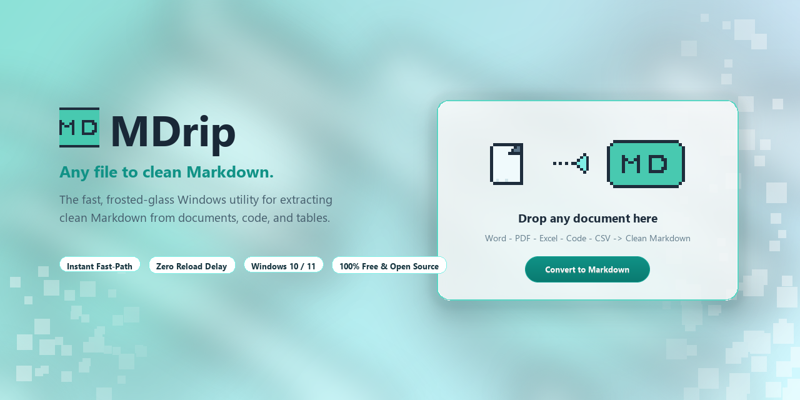

# MDrip 💧

<p align="center">
  
</p>

> **The token-optimizing desktop utility that converts bloated documents (Word, PDF, Excel, PowerPoint) into clean, high-density Markdown for LLMs & AI Coding Agents.**

<p align="center">
  <a href="https://github.com"></a>
  <a href="https://python.org"></a>
  <a href="LICENSE"></a>
  <a href="https://github.com/microsoft/markitdown"></a>
  
  
</p>

---

## 💡 Why MDrip? The "LLM Format Tax"

When you upload raw **DOCX**, **PDF**, **PPTX**, or **XLSX** files to models like **Claude 3.5**, **ChatGPT (GPT-4o)**, **Gemini 1.5**, or coding agents like **Cursor**, **Windsurf**, and **GitHub Copilot**, you are paying a heavy **"Format Tax"**:

1. **PDF Vision Overhead (1,500–3,000 tokens/page):**  
   Modern LLMs process uploaded PDFs through multimodal vision pipelines, rendering each page as an image. A 20-page PDF report with just 3,500 words of text can consume **30,000 to 60,000 tokens**! In Markdown, that exact same content is only **~4,500 tokens** — an **85% to 90% reduction**.
2. **XML & Style Bloat (DOCX & PPTX):**  
   Office files contain thousands of lines of hidden XML schemas (`w:p`, `w:rPr`, font mappings, revision GUIDs, style tables). When models ingest these raw containers, up to **35%–50% of the tokens** are wasted on non-semantic noise.
3. **Attention Degradation ("Lost in the Middle"):**  
   Transformer attention heads are diluted by formatting tags, layout instructions, and repetitive headers/footers. Clean Markdown structures data with `# Headings`, `* Lists`, and `| Tables |`, preserving semantic hierarchy without confusing the model.
4. **Coding Agent Blindspots (Cursor / Windsurf / Copilot / Antigravity):**  
   AI coding assistants cannot natively index or `@mention` binary `.docx` or `.pptx` files. Converting PRDs, design documents, and API specs into Markdown makes them instantly indexable across your repository.

---

### 📊 Benchmark: Raw File vs. MDrip Markdown

| Document Type | Raw File Token Usage | MDrip (`.md`) Token Usage | Token Savings | AI Quality Impact |
|---|---|---|---|---|
| **20-Page PDF Report** | **~42,000 tokens** *(Vision OCR)* | **~4,800 tokens** | **88.5% SAVED** | Eliminates visual hallucinations; instant ingestion |
| **15-Page Word Spec (`.docx`)** | **~11,200 tokens** *(Raw/Extracted XML)* | **~6,100 tokens** | **45.5% SAVED** | Sharp attention on business logic & constraints |
| **25-Slide Deck (`.pptx`)** | **~8,500 tokens** *(Layout tags)* | **~2,800 tokens** | **67.0% SAVED** | Pure content outline without coordinate clutter |
| **Data Sheet (`.csv` / `.xlsx`)** | **~6,400 tokens** *(Raw text/binary)* | **~2,900 tokens** *(GFM Table)* | **54.6% SAVED** | Aligns data with 2D tabular attention mechanisms |

> 💰 **Cost & Speed:** Cutting 80%+ of prompt tokens directly slashes API costs, accelerates generation latency, and prevents long documents from overflowing the context window.

---

## ✨ Features

- 🧊 **Frosted Mint-Aqua Liquid Glass UI:** Aesthetic desktop interface featuring multi-tier drop shadows, soft light blobs, and retro pixel-art sprites.
- ⚡ **Instant Fast-Path Engine:**
  - **CSV & TSV:** Formats into clean GitHub Flavored Markdown (GFM) tables in **< 15 ms**.
  - **Source Code & Config:** (`.py`, `.js`, `.ts`, `.html`, `.css`, `.json`, `.yaml`, `.xml`, `.sql`, etc.) wrapped into syntax-highlighted code fences in **< 3 ms**.
  - **Plain Text / Notes:** Read and output instantaneously.
- 🧠 **Pre-Warmed Engine Singleton:** Powered by [Microsoft MarkItDown](https://github.com/microsoft/markitdown). Heavy ONNX models initialize silently in the background, making startup instant (< 0.5s) and eliminating conversion reload delays.
- 🎯 **Interactive Drop Zone:** Animated marching cyan dotted border with real-time drag-and-drop feedback.
- 🗂️ **Frosted File Card:** Displays detected file-type badge, middle-truncated filename, size in KB/MB, and a quick **"✕"** clear button.
- 📂 **One-Click Explorer Access:** Click the green success status to open Windows Explorer with the converted `.md` file selected automatically.
- 🔋 **Zero Idle Footprint:** Adaptive frame-rate throttling drops animation to ~4 FPS when unfocused and pauses completely when minimized (0.0% background CPU).
- 🔒 **100% Offline & Private:** Zero API keys, zero cloud uploads. Your confidential documents never leave your machine.
- 📦 **Standalone Portable Executable:** Runs on Windows 10 and 11 without needing Python or external runtimes.

---

## 📄 Supported Formats

| Category | Extensions | Markdown Output |
|---|---|---|
| **Word Documents** | `.docx`, `.doc` | Structured headings, bold/italic, lists, tables |
| **PDF Documents** | `.pdf` | Structured text hierarchy, clean tables, no OCR noise |
| **Spreadsheets** | `.xlsx`, `.xls` | Markdown data tables |
| **Presentations** | `.pptx`, `.ppt` | Slide-by-slide text hierarchy and speaker notes |
| **Tabular Files** | `.csv`, `.tsv` | High-density GitHub Flavored Markdown tables |
| **Source Code** | `.py`, `.js`, `.ts`, `.html`, `.css`, `.json`, `.yaml`, `.xml`, `.sql`, `.sh`, `.ps1`, etc. | Fenced code blocks with language syntax tags |
| **Plain Text / Logs** | `.txt`, `.log`, `.md` | Clean, standardized Markdown |

---

## 🚀 Quick Start (No Python Required)

1. Head to the **[Releases](../../releases)** page and download **`MDrip.exe`**.
2. Double-click **`MDrip.exe`** to launch (no installation needed).
3. Drag any document onto the drop card (or click to browse).
4. Click **Convert to Markdown**.
5. Click the green link in the status bar to jump directly to your new `.md` file in Windows Explorer!

> [!TIP]
> **Windows Defender SmartScreen Notice:**  
> Because MDrip is a newly released, free open-source executable without a paid commercial certificate, Windows SmartScreen may show an unrecognized app notice on first launch. Simply click **"More info"** ➔ **"Run anyway"**.

---

## 🛠️ Build from Source

### Prerequisites
- Windows 10 or 11
- Python 3.10+

### Setup Commands

```powershell
# 1. Clone the repository
git clone https://github.com/<your-username>/MDrip.git
cd MDrip

# 2. Create and activate a virtual environment
python -m venv venv
.\venv\Scripts\Activate.ps1

# 3. Install dependencies
pip install -r requirements.txt

# 4. Generate the UI assets (pre-built assets already included)
python assets/generate_assets.py

# 5. Run MDrip in development mode
python app.py

# 6. Build the standalone executable
pyinstaller --noconfirm MDrip.spec
```

The compiled standalone binary will be output to `dist/MDrip.exe`.

---

## 🤝 Contributing

**Contributions are warmly welcome!** Whether you want to optimize token reduction, add new file parsers, improve conversion fidelity, or refine the UI, we'd love your help.

### Planned Roadmap & Good First Issues

- [ ] **Multi-File Batch Queue:** Drop an entire folder or multiple documents to convert in a batch.
- [ ] **One-Click "Copy to Clipboard":** Copy Markdown directly to clipboard without opening the file.
- [ ] **Dark Mode Glass Theme:** Deep navy and neon cyan glassmorphic aesthetic.
- [ ] **Custom Output Directory:** Configure a custom destination folder instead of saving next to the source.
- [ ] **Token Savings Counter:** In-app badge showing estimated tokens saved for each converted file.

### How to Contribute

1. **Fork** the repository on GitHub.
2. **Create a branch** for your feature or fix:
   ```bash
   git checkout -b feature/awesome-feature
   ```
3. **Commit** your changes:
   ```bash
   git commit -m "feat: Add one-click copy to clipboard"
   ```
4. **Push** to your fork:
   ```bash
   git push origin feature/awesome-feature
   ```
5. **Open a Pull Request** with a description of what you improved.

If you encounter any bugs or have ideas, please [open an issue](../../issues)!

---

## 📁 Repository Structure

```
MDrip/
├── app.py                  # Main GUI (Tkinter + Canvas + Adaptive Loop + Fast-Path)
├── assets/
│   ├── generate_assets.py  # Pillow code-driven vector/pixel asset generator
│   ├── background.png      # Frosted glass background canvas with drop card
│   ├── icon_idle.png       # Pixel-art sequence: Document -> Arrow -> MD badge
│   ├── file_card.png       # Frosted glass card for selected file state
│   ├── icon_doc.png        # Document pixel sprite
│   ├── icon_check.png      # Success checkmark sprite
│   ├── icon_warn.png       # Alert sprite
│   ├── btn_*.png           # Pill buttons (disabled, enabled, hover, pressed, done)
│   ├── social_preview.png  # 1280x640 OpenGraph repository banner
│   └── app_icon.ico        # Multi-size Windows application icon
├── MDrip.spec              # PyInstaller build configuration
├── requirements.txt        # Pinned dependencies
├── test_files/             # Sample test files (.docx, .pdf, .xlsx, .pptx, .csv, .txt)
├── LICENSE                 # MIT License
└── README.md               # Documentation & Token Research
```

---

## 📄 License

This project is licensed under the [MIT License](LICENSE) — free for personal and commercial use.

---

## 💖 Acknowledgments

- [Microsoft MarkItDown](https://github.com/microsoft/markitdown) — Core document conversion engine.
- [tkinterdnd2](https://github.com/pmgagne/tkinterdnd2) — Native drag-and-drop bindings.
- [Pillow (PIL)](https://python-pillow.org/) — Anti-aliased graphics and sprite generation.
- [PyInstaller](https://pyinstaller.org/) — Standalone executable compilation.
